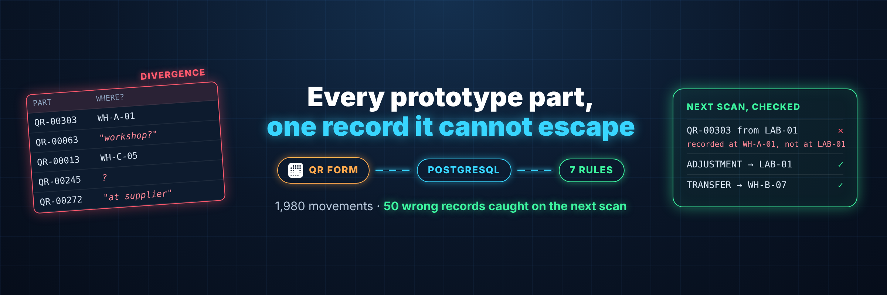
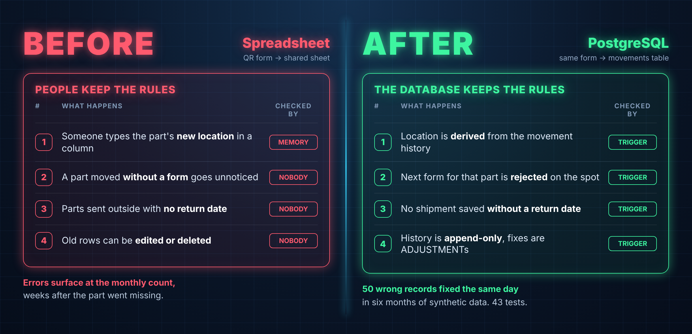
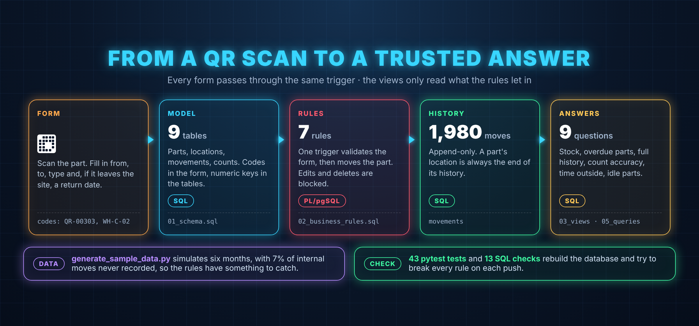
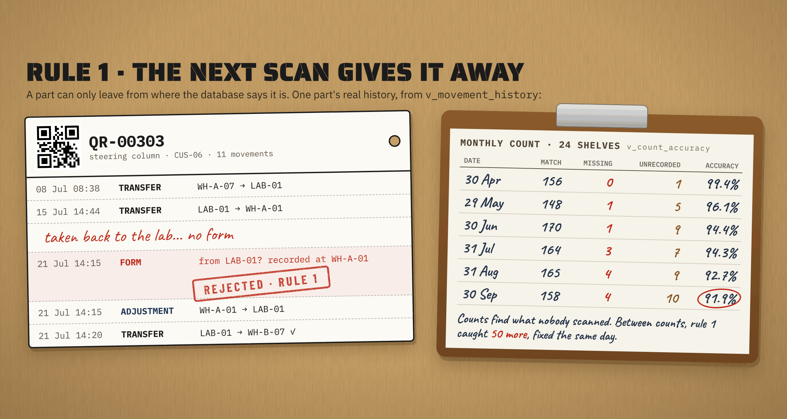
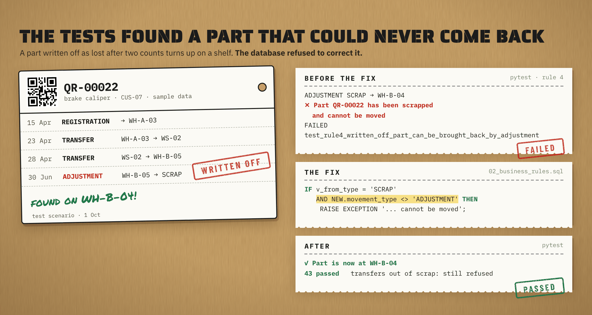
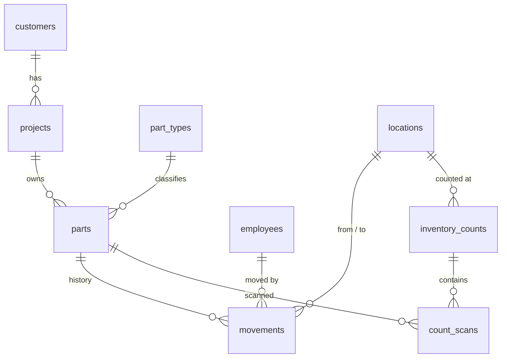

# Prototype Parts Inventory · PostgreSQL

A PostgreSQL database that tracks every prototype part by its QR code: where it is, where it has been and who moved it. The business rules live inside the database, so a wrong record is rejected when someone scans the part, not discovered weeks later at the monthly count.



[](https://github.com/lucasnunesf/prototype-inventory-sql/actions/workflows/database-checks.yml)


## At a glance

| | |
|---|---|
| **Result** | 1,980 movements in six months of synthetic data, every one validated by 7 rules. 50 wrong records caught the moment the part was scanned and fixed the same day. |
| **Real case** | During my internship at an automotive supplier I took part in the QR code project behind this repo. Inventory losses and movement rework fell by about 60%. |
| **My part here** | Data model, all business rules in PL/pgSQL, count closing, a reporting mart for Power BI, roles and row-level security, analysis queries, the six-month simulation, tests and CI. |
| **In the repo** | 10 SQL files · 10 tables · 2 triggers · 2 procedures · star schema with 2 materialized views · 3 roles · 12 business questions · 31 SQL checks · 47 pytest tests |
| **Skills** | PostgreSQL · SQL · PL/pgSQL (triggers, procedures) · data modelling · star schema · materialized views · window functions (`LEAD`, `LAG`, `RANK`, running totals) · gaps and islands · `percentile_cont` · roles and row-level security · data quality · Python · pytest · GitHub Actions |
| **Case study** | [Tracking prototype parts with QR codes (Notion)](https://lucasnunesf.notion.site/Tracking-prototype-parts-with-QR-codes-81a917c89c17830b82b38101d66af8e3) |

Why a rebuild: the real process ran on a form and a spreadsheet, and company data cannot be shared. This repository takes the same process one step further, into a database that enforces the rules itself, with fictional customers, parts and people.

---

## The problem

A prototype area handled **100+ part types for 10+ customers**. Parts left the shelves all the time: to the workshop, to tests, to other plants and to suppliers. There was no single record, so the records did not match the shelves and nobody knew for sure where a part was.

The team gave every part its own QR code. Scanning it opened a form, and a shared spreadsheet became the control. That fixed most of it, but the spreadsheet still trusted people to type the right thing.



## How it works



| Step | What it does | Language | Output |
|---|---|---|---|
| Model | Parts, locations, employees, movements and counts. The form uses codes, the tables use numeric keys | SQL | `01_schema.sql` |
| Rules | One trigger checks each form, then moves the part. Another blocks edits and deletes | PL/pgSQL | `02_business_rules.sql` |
| Views | Current stock, part history, parts outside and late, count reconciliation | SQL | `03_views.sql` |
| Data | Six months of the area, with forms people forgot to fill in | Python | `04_sample_data.sql` |
| Questions | Nine questions the team actually asks | SQL | `05_analysis_queries.sql` |
| Checks | Tries to break each rule and confirms the database refuses | SQL | `06_rule_checks.sql` |
| Count closing | After a monthly count, posts the corrections: found elsewhere, or missing twice and written off | PL/pgSQL | `07_count_closing.sql` |
| Reporting mart | Star schema for Power BI: date, part, location and employee dimensions, movement fact, daily stock, monthly KPIs | SQL | `08_reporting_mart.sql` |
| Roles | Form, logistics and Power BI each get only what they need. Row-level security stops the form posting an `ADJUSTMENT` | SQL | `09_access_roles.sql` |
| Feature checks | Proves 07, 08 and 09: same numbers as the views, same corrections as the simulation, each role refused where it should be | SQL | `10_feature_checks.sql` |

### The seven rules

| # | Rule | Where |
|---|---|---|
| 1 | A part can only leave from where the database says it is | Trigger `fn_process_movement` |
| 2 | Movement type must match the route (a `TRANSFER` cannot go to a supplier) | Trigger |
| 3 | Parts sent outside need an expected return date, and it cannot be in the past | Trigger + `CHECK` |
| 4 | Scrapped parts cannot move. Only an `ADJUSTMENT` can bring back a part written off by mistake | Trigger |
| 5 | No back-dating before the part's last movement | Trigger |
| 6 | History is append-only. Corrections are new `ADJUSTMENT` rows | Trigger `fn_block_history_changes` |
| 7 | A part's current location always comes from its movements | Trigger updates `parts` |

Rule 1 is the core. With the spreadsheet, a part moved without a form went unnoticed. Here, the next person who scans it gets an error, and the record is fixed on the spot:



## Results

Inventory accuracy per monthly count (`v_count_accuracy`):

| count_date | matched | missing | unrecorded | accuracy_pct |
|---|---|---|---|---|
| 2026-04-30 | 156 | 0 | 1 | 99.4 |
| 2026-05-29 | 148 | 1 | 5 | 96.1 |
| 2026-06-30 | 170 | 1 | 9 | 94.4 |
| 2026-07-31 | 164 | 3 | 7 | 94.3 |
| 2026-08-31 | 165 | 4 | 9 | 92.7 |
| 2026-09-30 | 158 | 4 | 10 | 91.9 |

- **missing**: the database had the part on that shelf, but it was not there.
- **unrecorded**: the part was on that shelf, but the database had it somewhere else.

Accuracy drops as more parts circulate, because the simulation leaves 7% of internal movements unrecorded on purpose. Each count fixes what it finds. Between counts, rule 1 caught and fixed 50 more.

The twelve questions in [`sql/05_analysis_queries.sql`](sql/05_analysis_queries.sql):

| # | Question | SQL used |
|---|---|---|
| Q1 | How many parts does each customer have, and where? | `FILTER`, conditional aggregation |
| Q2 | Which parts are outside and late? Who sent them? | Set-returning function, `LATERAL` |
| Q3 | Full history of one part | View over the audit trail |
| Q4 | Inventory accuracy per count | `FULL JOIN` reconciliation |
| Q5 | What was wrong in the last count, and where did the database have it? | Point-in-time lookup |
| Q6 | How long do parts stay outside, and how many come back on time? | `LEAD()` |
| Q7 | How often were records corrected, and why? | `date_trunc`, grouping |
| Q8 | Parts untouched on a shelf for 60+ days | Date arithmetic |
| Q9 | Busiest shelf positions | `RANK()`, `SUM() OVER ()` |
| Q10 | How long does a part stay at each kind of place? | `LEAD()`, `percentile_cont` (median and p90) |
| Q11 | Which customers make up 80% of the work? | Pareto with running totals |
| Q12 | Which shelves were wrong in 3+ counts in a row? | Gaps and islands |

Some answers: a part sent to a supplier stays a median of 21 days, against 4 in the test lab. 7 of the 11 customers make up 80% of the movements. Shelf WH-A-01 was wrong in five counts in a row, from May to September, the first place to look at how parts are put away.

## Closing a count in SQL

After each monthly count, logistics fixes the records: a part found on another shelf is moved to where it was found, and a part missing in two counts in a row is written off. In the sample data the Python simulation does this. `07_count_closing.sql` writes the same rule once in SQL, so the database can close any future count on its own:

```sql
CALL sp_close_count_round('2026-10-30 16:00', 'EMP-12');
-- NOTICE:  Count round 2026-10-30 16:00:00 closed: 2 adjustments posted
```

To make sure the SQL is right, `fn_count_adjustments()` is run on the six past counts and compared with what the simulation posted: the same 42 corrections, same parts, same places, same minute. The procedure refuses a round that is already closed or where a shelf was not counted, and every adjustment it posts still goes through the rules trigger.

## Ready for Power BI

`08_reporting_mart.sql` builds a separate `mart` schema, so the report never reads the operational tables:

```
dim_date   dim_part   dim_location   dim_employee
     \         |            |            /
      fact_movement     fact_daily_stock     kpi_monthly
```

`fact_daily_stock` answers "how many parts were where, on any day", and `kpi_monthly` gives the first page of the report:

| month | movements | shipments | returned on time | count accuracy | active parts | overdue outside |
|---|---|---|---|---|---|---|
| Apr 2026 | 315 | 15 | 66.7% | 99.4% | 189 | 3 |
| May 2026 | 291 | 24 | 66.7% | 96.1% | 204 | 10 |
| Jun 2026 | 326 | 22 | 59.1% | 94.4% | 222 | 8 |
| Jul 2026 | 343 | 35 | 55.6% | 94.3% | 236 | 14 |
| Aug 2026 | 372 | 29 | 55.6% | 92.7% | 257 | 24 |
| Sep 2026 | 333 | 32 | 44.0% | 91.9% | 245 | 20 |

"Overdue outside" is worked out as it was at the end of each month, not as it is today. The two heavy tables are materialized views, refreshed with `CALL mart.sp_refresh()` without locking the report.

## Who can do what

| Role | Can | Cannot |
|---|---|---|
| `inv_form_app` | Look up codes, insert movements | Post an `ADJUSTMENT` (row-level security), write a part's location |
| `inv_logistics` | Everything the form can, plus adjustments, counts and closing a round | Edit or delete history |
| `inv_bi_reader` | Read the `mart` schema | Read the operational tables |

The rules trigger runs as `SECURITY DEFINER` with a fixed `search_path`, so the form can move a part without having write access to `parts`.

## Design decisions

- **Location is calculated, not typed.** `parts.current_location_id` is only written by the trigger. The current location and the history cannot disagree.
- **Validation in a `BEFORE` trigger.** An `AFTER` row trigger only runs when the whole `INSERT` ends, so in a batch the second movement of a part would still see the old location.
- **Append-only history.** A mistake is fixed with an `ADJUSTMENT`, so every correction stays visible (Q7).
- **Counts store what was found, not the difference.** `count_scans` holds the scanned QR codes. The comparison is a view that rebuilds where the database had each part at the moment of the count (`fn_location_at`).
- **Business logic in SQL, simulation in Python.** Python only plays the people on the floor, including their mistakes. What the company would actually run (rules, count closing, reporting, permissions) lives in the database.
- **Synthetic data with mistakes built in.** The generator tracks where each part really is and where the database thinks it is, so the rules and the counts have something real to catch. Fixed seed, standard library only.

More in [docs/data-model.md](docs/data-model.md).

## Try it

**In the browser, no installation:** create a free database on [Neon](https://neon.tech), open the SQL Editor and run the files in `sql/` in order, `01` to `10`. For your own queries, start with `SET search_path TO inventory;`.

**With PostgreSQL installed:**

```bash
createdb inventory
for f in sql/*.sql; do psql -d inventory -v ON_ERROR_STOP=1 -f "$f"; done
```

`06` and `10` print their checks:

```
                     check_name                      | result |
-----------------------------------------------------+--------+------------------------------------------------------
 Rule 1 - part must leave from its recorded location | PASS   | Part QR-00303 is recorded at WH-C-02, not at WH-A-01
 Rule 2 - TRANSFER cannot go to a supplier           | PASS   | A TRANSFER must be between internal locations
 Rule 3 - SHIPMENT needs an expected return date     | PASS   | Parts sent outside the site need an expected return date
 Rule 4 - scrapped parts cannot move                 | PASS   | Part QR-00317 has been scrapped and cannot be moved
 Rule 4 - a written-off part can be found again      | PASS   | Part is now at WH-B-04
 Rule 6 - history cannot be edited                   | PASS   | Movements are append-only (UPDATE blocked). Record an ADJUSTMENT instead.
 ...
(13 rows)

       area       |                     check_name                      | result |
------------------+-----------------------------------------------------+--------+------------------------------------------------
 08 mart          | daily stock on 30 Sep = current stock               | PASS   | 245 parts on hand, v_current_stock has 245
 07 count closing | SQL rule = simulation, all 6 counts                 | PASS   | 42 adjustments, same parts, places and times
 07 count closing | part missing twice in a row is written off          | PASS   | QR-00092 is now at SCRAP
 09 roles         | form app cannot post an ADJUSTMENT                  | PASS   | new row violates row-level security policy for table "movements"
 09 roles         | Power BI cannot read the operational tables         | PASS   | permission denied for schema inventory
 ...
(18 rows)
```

**Regenerate the sample data:**

```bash
python scripts/generate_sample_data.py
```

```
Wrote .../sql/04_sample_data.sql
  parts:          320
  movements:      1980
  rejected forms: 50
  shelf counts:   144
  scans:          1002
```

## Tests

```bash
pip install -r requirements-dev.txt
pytest
```

```
47 passed in 9.24s
```

The tests create a throwaway database (using the usual `PG*` variables), build it from the files in `sql/` and drop it at the end.

| File | Level | What it checks |
|---|---|---|
| `test_generator.py` | Unit | SQL literals, business days, month ends, simulation totals, and that the committed `04_sample_data.sql` is exactly what the script produces |
| `test_business_rules.py` | Business rules | Each rule rejects the wrong form for the right reason, and each valid route goes through |
| `test_end_to_end.py` | End to end | Row counts, the accuracy table above, overdue parts, the monthly KPIs, SQL count closing = simulation, row-level security, and all queries and SQL checks run |

GitHub Actions builds the database on PostgreSQL 16 and runs both the SQL checks and pytest on every push.

The tests found a real gap. A part written off as lost after two missed counts could never be corrected, because rule 4 blocked every movement out of the scrap area. If that part turned up on a shelf, the database would keep calling it scrapped. Rule 4 now accepts an `ADJUSTMENT` out of scrap, and nothing else.



The QR codes in these images are real: scan them and you get the synthetic part code (`QR-00303`, `QR-00022`).

<details>
<summary>Repository structure</summary>

```
prototype-inventory-sql/
├── sql/
│   ├── 01_schema.sql            tables, keys and constraints
│   ├── 02_business_rules.sql    triggers and helper function
│   ├── 03_views.sql             stock, history, overdue parts, count reconciliation
│   ├── 04_sample_data.sql       generated synthetic data
│   ├── 05_analysis_queries.sql  twelve business questions
│   ├── 06_rule_checks.sql       SQL checks of every rule
│   ├── 07_count_closing.sql     procedure that closes a monthly count
│   ├── 08_reporting_mart.sql    star schema and KPIs for Power BI
│   ├── 09_access_roles.sql      roles, grants and row-level security
│   └── 10_feature_checks.sql    SQL checks of 07, 08 and 09
├── scripts/
│   └── generate_sample_data.py  six-month simulation
├── tests/                       pytest: generator, rules, end to end
├── docs/
│   ├── data-model.md            ER diagram and design decisions
│   └── *.png                    images in this README
└── .github/workflows/
    └── database-checks.yml      builds the database and runs all checks on every push
```
</details>

<details>
<summary>Data model</summary>



Columns and table descriptions: [docs/data-model.md](docs/data-model.md).
</details>

<details>
<summary>Glossary</summary>

- **Prototype part**: a physical sample built for a vehicle program before mass production. Each one is tracked on its own.
- **Movement types**: `REGISTRATION` (arrives), `TRANSFER` (inside the site), `SHIPMENT` (to a plant or supplier), `RETURN` (back to the site), `SCRAP`, `ADJUSTMENT` (fixes the record).
- **Divergence**: when the record and the shelf disagree.
</details>

## Next steps

- Power BI report on the `mart` schema, connected as `inv_bi_reader`.
- A small web form that writes straight to `movements`, replacing the spreadsheet step.

## How this was built

The problem, the business rules and the design decisions are mine. They come from my internship in the prototype area at Bosch do Brasil. I used an AI coding assistant to write the code faster and reviewed the result.


## Author

**Lucas Fernandes Nunes** · [LinkedIn](https://linkedin.com/in/lucas-fernandes-nunes-335867256) · [Portfolio](https://lucasnunesf.notion.site)

*All customers, projects, part types, locations and employees are fictional. No company data is used in this repository.*
