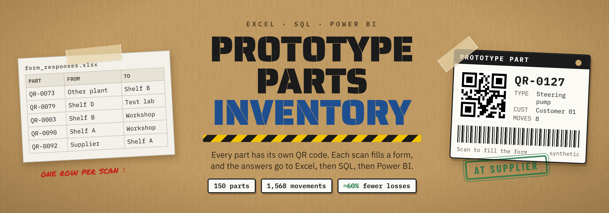
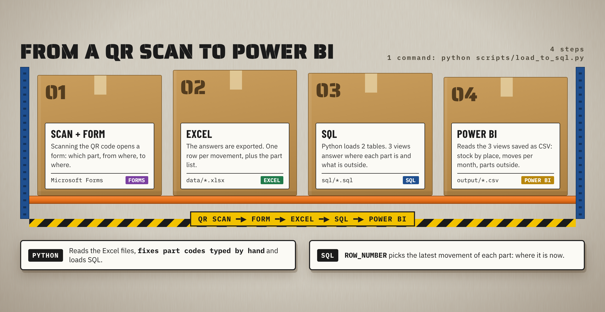
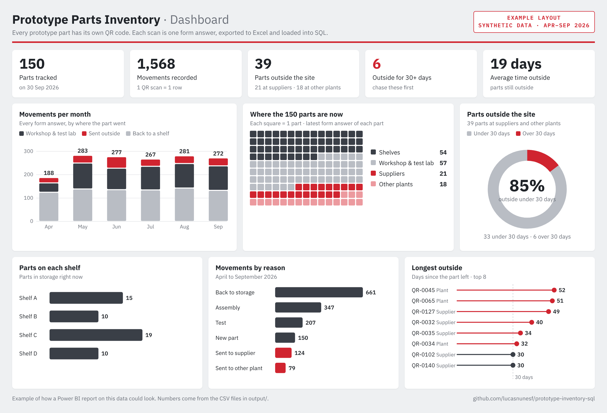

# Prototype Parts Inventory



Tracking prototype parts with a QR code on every part. Each scan fills a form, and the answers go to **Excel**, then **SQL**, then **Power BI**.

| | |
|---|---|
| **Real case** | During my internship at an automotive supplier, I was part of the team that set up this process in the prototype area. Inventory losses and rework from moving parts fell by about 60%. |
| **This repo** | The same flow rebuilt with fake data: form answers in Excel, loaded into a SQL database, ready for Power BI. |
| **Tools** | Microsoft Forms · Excel · Python (pandas) · SQL · Power BI |
| **Case study** | [Tracking prototype parts with QR codes](https://lucasnunesf.notion.site/Tracking-prototype-parts-with-QR-codes-81a917c89c17830b82b38101d66af8e3) |

All names and codes are invented. No company data is used.

---

## The problem

The prototype area had more than 100 part types for more than 10 customers. Every prototype is unique and moves all the time: to the workshop, to the test lab, to suppliers and to other plants.

Each person kept track of their own parts in their own way. So the records did not match the shelves, and nobody knew for sure where a part was.

## The solution

1. Every part gets its own **QR code**.
2. Scanning the code opens a **form**: which part, from where, to where and why.
3. The form answers go to **Excel**, one row per movement.
4. The Excel data is loaded into **SQL**, where simple queries answer the daily questions.
5. **Power BI** shows where every part is and which parts are outside.



## What is in this repo

```
data/
  parts.xlsx              150 parts: code, part type, customer
  form_responses.xlsx     1,568 form answers, one per movement
scripts/
  generate_data.py        creates the two fake Excel files
  load_to_sql.py          reads the Excel files, cleans them, loads SQL, saves CSVs
sql/
  01_tables.sql           2 tables: parts and movements
  02_views.sql            3 views used by Power BI
  03_questions.sql        5 questions asked every week
output/
  current_location.csv    where every part is now
  movements_by_month.csv  movements per month and reason
  parts_outside.csv       parts at suppliers or other plants, and for how many days
```

## How it works

**1. Excel.** The form export has one row per scan: date and time, who scanned, part code, from, to and reason. A second file lists the parts.

**2. Python loads SQL.** `load_to_sql.py` reads both files with pandas and fixes two things:

- part codes typed by hand (`qr-0012`, ` QR-0012 `, `QR0012`) become `QR-0012`
- dates in day/month/year are read correctly

Then it creates the tables in a SQLite database and inserts the rows. If a form answer has a part code that is not in the part list, it stops and shows the code.

**3. SQL views.** Three views answer the main questions:

| View | Question | How |
|---|---|---|
| `v_current_location` | Where is each part now? | `ROW_NUMBER()` picks the latest movement of each part |
| `v_movements_by_month` | How many movements per month? | `GROUP BY` month and reason |
| `v_parts_outside` | Which parts are outside, and for how long? | Filters the current location and counts the days |

**4. Power BI.** Each view is saved as a CSV in `output/`. Power BI reads these three files: stock by place, movements per month and a list of parts outside, oldest first.

## Example dashboard

> **This is only an example** of how a Power BI report on this data could look. It is an image built from the CSV files in `output/`, not a Power BI file.



## Results (fake data)

| | |
|---|---|
| Parts | 150 |
| Movements in six months | 1,568 |
| Parts outside the site today | 39 (21 at suppliers, 18 at other plants) |
| Parts outside for more than 30 days | 6, the first ones to chase |

## Try it

```bash
pip install -r requirements.txt
python scripts/generate_data.py    # optional: the Excel files are already in data/
python scripts/load_to_sql.py      # creates inventory.db and the CSV files
```

To run the questions, open `inventory.db` in any SQLite tool (for example DB Browser for SQLite) and run `sql/03_questions.sql`.

## How this was built

The process and the questions come from my internship. I used an AI coding assistant to write the code faster and reviewed the result.

---

**Lucas Fernandes Nunes** · [LinkedIn](https://www.linkedin.com/in/lucasfernandesnunes) · [Portfolio](https://lucasnunesf.notion.site/Lucas-Nunes-Data-BI-Analyst-3de917c89c178092885cf639b619767b)
